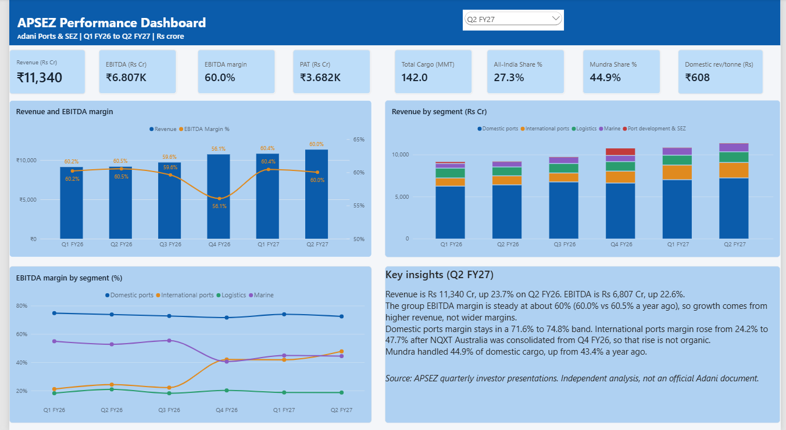

# APSEZ Port Performance Dashboard (Q1 FY26 to Q2 FY27)

Independent analysis of **Adani Ports & Special Economic Zone (APSEZ)** using the company's public quarterly investor presentations. Built end to end with **Excel, PostgreSQL and Power BI**.

> Not an official Adani document. All figures come from public filings and are in Rs crore unless stated.



## Business questions
1. How are revenue, EBITDA and margins trending, and what drives growth?
2. Which segments (Domestic ports, International ports, Logistics, Marine, SEZ) earn the most, and how do their margins differ?
3. How concentrated is cargo on Mundra, and is APSEZ gaining share of India's port cargo?

## Pipeline
| Stage | Tool | What I did |
|---|---|---|
| Collect | Excel | Entered figures from 6 quarterly decks into a structured workbook with dropdowns and automatic reconciliation checks |
| Model | PostgreSQL | Star schema: 3 dimensions + 6 fact tables, plus a view that applies restated figures |
| Validate | SQL | Segment totals vs consolidated, port volumes vs reported totals, cluster totals vs segment |
| Analyse | SQL | CTEs, window functions (`DENSE_RANK`), conditional aggregation |
| Visualise | Power BI | Star-schema model, 20+ DAX measures (YoY, margins, shares, revenue per tonne), one-page dashboard |

## Key findings (Q2 FY27)
- Revenue **Rs 11,340 Cr, +23.7%** vs Q2 FY26; EBITDA **Rs 6,807 Cr, +22.6%**.
- Group EBITDA margin is steady at about **60%** (60.0% vs 60.5%), so growth comes from higher revenue, not wider margins.
- Domestic ports margin stays within **71.6% to 74.8%**. International ports margin rose from **24.2% to 47.7%** after NQXT Australia was consolidated from Q4 FY26, so that rise is not organic.
- Mundra handled **44.9%** of domestic cargo (43.4% a year earlier).

## Data notes and limitations
- Only **6 quarters** are covered, so trends are short and year-on-year comparisons exist only for Q1 and Q2 FY27.
- Q1 FY26 Domestic ports was **restated** in a later deck; both versions are stored and the view uses the restated one.
- FY26 port-level volumes are **totals read from chart slides**; the coal / container / liquid split sits in an Excel file embedded in each deck and was not extracted. "Terminals" volumes for Q2 and Q3 FY26 are derived (domestic total minus listed ports).
- Q1 FY26 PBT is derived from the 9M and H1 totals.
- In Q2 FY27 the port-level volumes sum about **1 MMT below** the reported domestic total (likely an East-coast port entry); the dashboard uses reported totals.
- Port-level revenue/EBITDA exists only up to Q4 FY26; cluster-wise reporting starts in Q1 FY27 and is **not comparable**.
- "Domestic revenue per tonne" is indicative: Domestic ports segment revenue divided by domestic cargo.

## Repository
```
data/        APSEZ_Data_Entry_FINAL.xlsx
sql/         01_create_tables.sql, 02_load_data.sql, 03_validation_checks.sql, 04_analysis_queries.sql
powerbi/     APSEZ_Dashboard.pbix, APSEZ_Dashboard.pdf, apsez_dashboard.png
```

## How to reproduce
1. Install PostgreSQL and create a database named `apsez_db`.
2. Run the four SQL files in order.
3. Open the `.pbix` in Power BI Desktop, then **Transform data > Data source settings** and point it to your own `localhost` / `apsez_db`.

## Source
Adani Ports & SEZ Ltd, Investor Downloads (quarterly operational and financial highlights): https://www.adaniports.com/investors/investor-downloads
